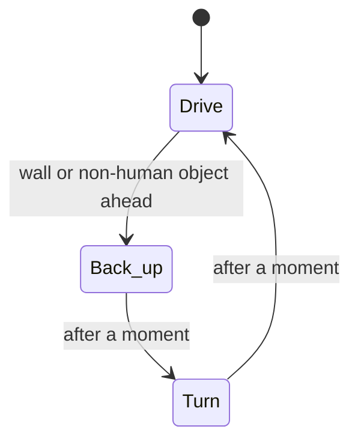

# First Responder Robot

A simulated robot that explores a disaster-style arena on its own. Our goal is a robot that can **search for a person in need and bring them supplies**, helping first responders in places that are unsafe to enter.

*CSCI 39536: Introduction to Robotics, group project.* 
**Team:** 
Shernice Chetty
Sheea Mcfarlane
Brian Mai 
Stanley Zheng
Sam Lin
Oscar Pan

## Where we are

| | Feature | Status |
|---|---|---|
| ✅ | Explore the arena on its own | Working |
| ✅ | Detect and avoid walls and objects(LIMITATION - ORANGE OBJECTS CURRENTLY)  | Working |
| 🔜 | Find a victim marker | Next |
| 🔜 | Deliver supplies | Planned |
| 🔜 | Pick up rubble and debris | Planned |
| 🔜 | Human stop override and safe approach distance | Planned |

## How to run

You need [Webots](https://cyberbotics.com) (version R2025a or newer) and Python 3.8+.

1. Open Webots.
2. Choose **File → Open World…** and pick `worlds/building_site.wbt`.
3. Choose **File → Open Text File…** and pick `controllers/robot_controller/robot_controller.py`.
4. Press **Play**.

The robot starts outside the building's main entrance, drives around and turns away from walls. The first run needs an internet connection, because Webots downloads the robot and arena models (it can take a minute or two).

> **Tip:** If Webots asks to save the world when you close or reload it, choose **Don't Save**.

## How it works

The robot is a Pioneer 3-AT with distance sensors (sonars) on its front. It keeps a simple routine going:

- **Drive:** go straight while the front sensors see nothing close.
- **Back up:** when a wall or an non-human object is close, reverse briefly to get clear of it.
- **Turn:** rotate toward whichever side has more room, then drive again.

The code is in [controllers/robot_controller/robot_controller.py](controllers/robot_controller/robot_controller.py), and the arena is in [worlds/building_site.wbt](worlds/building_site.wbt).

## The building site

The arena models a partly collapsed building on a 26 m × 18 m lot. The building is 20 m × 12 m, with 3.5 m outer walls and 3 m inner walls, and has one area for each scenario we want to demonstrate.

| Area | What's there |
|---|---|
| Collapsed zone (north-west) | The upper floor fell in: tilted floor slabs, a rubble heap, a snapped column with rebar, a hanging piece of floor. The outer walls here are broken and rubble spills outside. |
| Utility room | Flooded floor, a fallen air duct. **Victim 1** stands on dry floor, clear of the water. |
| Office (north-east) | A desk on fire (flames along its top, with smoke), burnt furniture. |
| Corridor | Runs the length of the building. A ceiling slab hangs off its wall and falls into it. |
| Lobby and entrance | Overturned reception desk, fallen lintel and rubble in the doorway. |
| Office (south-west) | Ceiling slab leaning across the corner, desks. **Victim 2** stands on open floor, clear of the slab. |
| Chemical lab | Leaking drums, green toxic spill, yellow acid spill, a pool of spilled chemicals on fire, gas cylinders. |

- **Uneven ground:** rolling bumps everywhere (up to about 60 cm outside, 40 cm inside), plus rubble heaps up to about 1 m.
- **Falling debris:** two pieces are still attached to walls: a ceiling slab hanging off the corridor wall, and a cracked chunk of brick wall over the doorway to the collapsed zone. When the robot comes within 4 m, the piece shakes for about a second, then breaks loose and falls into the robot's path. Everything else is static, which keeps the physics light.
- **Spills, water and fire** The robot will need to identify hazards and avoid them.
- **Victims** are human models standing upright.

## Known limitations

- The turns are a fixed length, so the robot doesn't cover the arena systematically.
- It reverses without checking what is behind it.
- It can't find victims or deliver anything yet.

## What we learned from testing

Our first runs showed us three problems, and each one changed the design:

- **The robot drove off the arena.** The default walls are only 10 cm high, so the robot rolled right over them. We raised the walls to 50 cm.
- **The robot spun in circles.** It treated the far wall as an obstacle right in front of it. We changed the distance threshold so it only reacts to walls that are actually close.
- **The robot got stuck against walls.** When a wall is very close, the sensor stops reporting it, so the path looked clear and the robot kept pushing. Now the robot remembers a recent close reading, backs up, and then turns.

## Troubleshooting

Common setup problems

- **"Python was not found":** In Webots, go to **Settings → General → Python command**. Type the full path to Python by hand.
- **"Missing declaration" errors:** Pull the latest version of the world file.
- **The folders don't load:** Keep `worlds/` and `controllers/` side by side.

## How we used AI
We used Claude Code to help set up Webots and debug errors.
